# Industrial Predictive Maintenance & Intelligence Platform

An end-to-end industrial predictive maintenance and machine intelligence project combining digital twin simulation, hybrid AI diagnostics, fleet intelligence, maintenance planning, and mathematical optimization.

The system simulates industrial equipment, analyzes sensor readings, detects potential machine faults, generates maintenance work orders, and optimizes technician schedules using Google OR-Tools CP-SAT.

🚀 **Live Demo**

Live Dashboard: [https://predictive-maintenance-ai-hjtlxffgfvdc7jd6dofuh5.streamlit.app/](https://predictive-maintenance-ai-hjtlxffgfvdc7jd6dofuh5.streamlit.app/)

The application is deployed on Streamlit Community Cloud.

## Key Features

**Industrial Digital Twin:** Multi-machine simulation with configurable operating conditions, degradation, sensor readings, and controlled fault injection.

**Hybrid AI Diagnostics:** XGBoost failure prediction, Isolation Forest anomaly detection, synthetic fault classification, and sensor quality assessment.

**Explainable AI:** SHAP-based feature contribution analysis for understanding model predictions.

**Fleet Intelligence:** Fleet health analysis, machine severity classification, rule-based risk ranking, fault frequency analysis, and maintenance recommendations.

**Maintenance Planning:** Automated maintenance work order generation, fault-specific maintenance requirements, spare parts forecasting, and technician capacity planning.

**Maintenance Optimization:** Google OR-Tools CP-SAT optimization for technician assignment, scheduling constraints, and maintenance strategy comparison.

**Interactive Dashboard:** Streamlit interface for executive overview, fleet intelligence, AI diagnostics, maintenance operations, and optimization results.

## System Architecture

```text
Industrial Digital Twin
        |
        v
Multi-Machine Simulation
        |
        v
Sensor Readings & Fault Injection
        |
        v
Hybrid AI Diagnostic Engine
        |
        +---- XGBoost Failure Prediction
        +---- Isolation Forest Anomaly Detection
        +---- Fault Classification
        +---- Sensor Quality Assessment
        |
        v
Fleet Intelligence
        |
        +---- Fleet Health Analysis
        +---- Machine Risk Ranking
        +---- Fault Frequency Analysis
        |
        v
Maintenance Planning
        |
        +---- Work Order Generation
        +---- Spare Parts Forecasting
        +---- Technician Capacity Planning
        |
        v
OR-Tools CP-SAT Optimization
        |
        +---- Technician Assignment
        +---- Scheduling Constraints
        +---- Strategy Comparison
        |
        v
Interactive Streamlit Dashboard
```

## Technology Stack

| Category | Technologies |
|---|---|
| Language | Python 3.12 |
| Data Processing | Pandas, NumPy |
| Machine Learning | Scikit-learn, XGBoost |
| Anomaly Detection | Isolation Forest |
| Explainable AI | SHAP |
| Optimization | Google OR-Tools CP-SAT |
| Visualization | Plotly |
| Dashboard | Streamlit |
| Testing | Python unittest |
| Version Control | Git, GitHub |

## Dataset

The XGBoost failure prediction model uses the UCI AI4I 2020 Predictive Maintenance dataset.

Original dataset characteristics:

| Dataset characteristic | Value |
|---|---:|
| Total records | 10,000 |
| Original columns | 14 |
| Normal records | 9,661 |
| Machine failure records | 339 |
| Missing values | 0 |
| Duplicate records | 0 |

The dataset contains machine operating information such as air temperature, process temperature, rotational speed, torque, tool wear, and machine type.

Dataset: [AI4I 2020 Predictive Maintenance Dataset – UCI Machine Learning Repository](https://archive.ics.uci.edu/dataset/601/ai4i+2020+predictive+maintenance+dataset)

The industrial digital twin and controlled fault injection experiments use simulated data.

## Industrial Simulation

The platform uses a simulated industrial environment containing multiple machines and controlled operating scenarios.

Current simulation configuration:

| Metric | Result |
|---|---:|
| Machines simulated | 8 |
| Simulation cycles | 100 |
| Diagnostic scenarios | 8 |
| Maintenance work orders | 7 |
| Machines without work orders | 1 |
| Maintenance scheduling days | 2 |

The simulator generates machine operating conditions, health information, sensor readings, and controlled fault scenarios.

## AI Diagnostics and Model Development

The platform combines multiple machine learning components for failure prediction, anomaly detection, and fault diagnosis.

### XGBoost Failure Prediction

The XGBoost failure prediction model was trained and evaluated using the UCI AI4I 2020 Predictive Maintenance dataset.

Final held-out test results:

| Metric | Score |
|---|---:|
| Precision | 0.8393 |
| Recall | 0.6912 |
| F1 Score | 0.7581 |
| ROC-AUC | 0.9784 |
| PR-AUC | 0.7493 |

The model uses machine operating features such as air temperature, process temperature, rotational speed, torque, tool wear, and machine type.

### Anomaly Detection

Isolation Forest is used for identifying anomalous machine operating conditions.

Machine-held-out evaluation results from controlled synthetic fault experiments:

| Metric | Score |
|---|---:|
| Precision | 0.9144 |
| Recall | 0.8354 |
| F1 Score | 0.8731 |
| ROC-AUC | 0.9958 |
| PR-AUC | 0.9635 |

The project also includes synthetic fault classification and multi-label fault diagnostics experiments.

These synthetic evaluation results should not be interpreted as evidence of equivalent performance on real industrial equipment.

### Explainable AI – SHAP

SHAP is integrated to analyze feature contributions and help interpret model predictions.

The explanation module identifies the features contributing to individual model predictions. Feature attribution does not establish physical causation.

## Fleet Intelligence

The fleet intelligence module provides:

- Fleet-level health analysis.
- Machine severity classification.
- Rule-based machine risk ranking.
- Fault frequency analysis.
- Maintenance action recommendations.
- Sensor-quality fleet assessment.
- Machine prioritization.

The machine risk ranking uses a transparent rule-based scoring system rather than a calibrated failure probability.

## Intelligent Maintenance Planning

The maintenance planning module automatically generates work orders based on detected faults and machine conditions.

Supported functionality includes:

- Fault-specific maintenance requirements.
- Automated work order generation.
- Spare parts forecasting.
- Technician capacity planning.
- Maintenance scheduling.
- Estimated maintenance cost and downtime.

The current integrated simulation generated 7 maintenance work orders across 2 scheduling days.

Estimated maintenance cost: 2,870 simulation units.

Estimated downtime: 25 hours.

These are simulation estimates, not validated real-world maintenance costs.

## CP-SAT Maintenance Optimization

The project uses Google OR-Tools CP-SAT to optimize technician assignments and maintenance schedules.

The optimization framework considers:

- Technician assignment.
- Technician scheduling constraints.
- Prevention of overlapping jobs.
- Maintenance priorities.
- Job completion times.
- Scheduling strategy comparisons.

Five scheduling strategies are compared:

1. Priority First
2. Shortest Processing Time
3. Severity First
4. FIFO
5. OR-Tools Optimal

### Optimization Results

| Metric | Result |
|---|---:|
| Optimization scenarios | 25 |
| Scheduling strategies compared | 5 |
| CP-SAT optimality proven | 25/25 |
| Average makespan | 12.50 hours |

The results represent controlled optimization experiments. Optimality is established for the tested scenarios where the solver reports an optimal status.

## Interactive Dashboard

The Streamlit application provides five pages:

- Executive Overview
- Fleet Intelligence
- AI Diagnostics
- Maintenance Center
- Optimization Lab

The dashboard provides visual insights into machine health, fleet risk, fault diagnostics, maintenance operations, and optimization results.

## Running the Project

### Prerequisites

- Python 3.12
- Git
- Virtual environment support

### 1. Clone the repository

```bash
git clone https://github.com/vinayydv2025-del/Predictive-Maintenance-AI.git
cd Predictive-Maintenance-AI
```

### 2. Create a virtual environment

```bash
python -m venv .venv
```

Activate it in Windows PowerShell:

```powershell
.venv\Scripts\Activate.ps1
```

### 3. Install dependencies

```bash
python -m pip install -r requirements.txt
```

### 4. Generate the integrated platform report

```bash
python run_platform.py
```

### 5. Launch the dashboard

```bash
streamlit run app/dashboard.py
```

Open the local URL provided by Streamlit, usually:

```text
http://localhost:8501
```

## Testing

The project includes automated tests for:

- Platform integration and pipeline validation.
- Digital twin and simulation stages.
- Fault and diagnostic consistency.
- Maintenance planning constraints.
- Technician scheduling feasibility.
- Optimization scenario validation.
- Solver status and optimality reporting.
- Work order and machine references.

Run the platform integration test suite:

```bash
python -m unittest -v tests.test_platform_integration
```

Latest verified platform integration result: 17 tests passed.

## Project Structure

```text
Predictive-Maintenance-AI/
│
├── app/
│   ├── dashboard.py
│   ├── components/
│   └── pages/
│
├── config/
│
├── data/
│
├── docs/
│
├── models/
│
├── notebooks/
│
├── reports/
│
├── screenshots/
│
├── src/
│   ├── simulation/
│   ├── intelligence/
│   ├── fleet_intelligence/
│   └── maintenance_planning/
│
├── tests/
│
├── run_platform.py
├── requirements.txt
└── README.md
```

## Dashboard Screenshots

### 1. Executive Overview

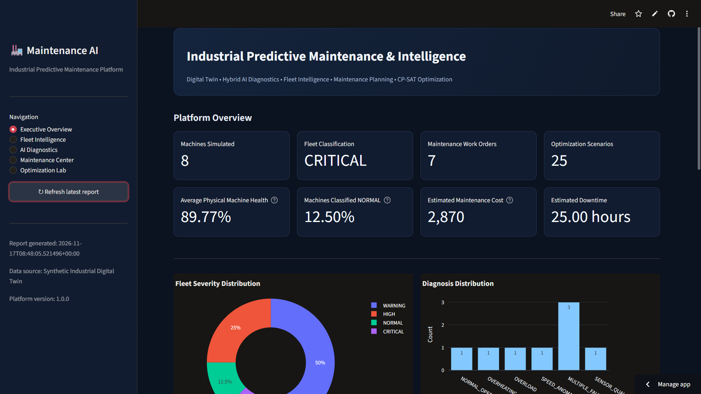

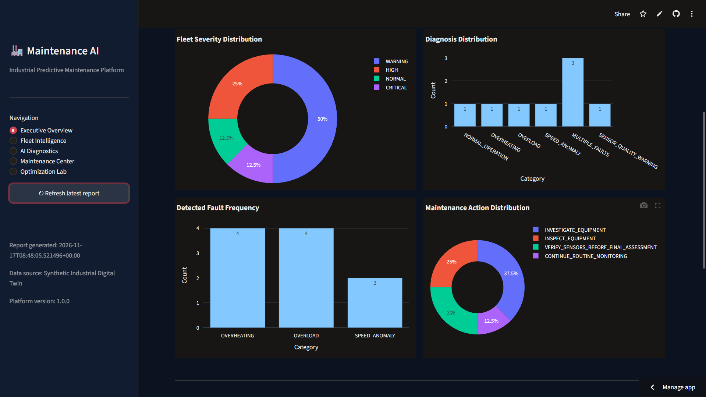

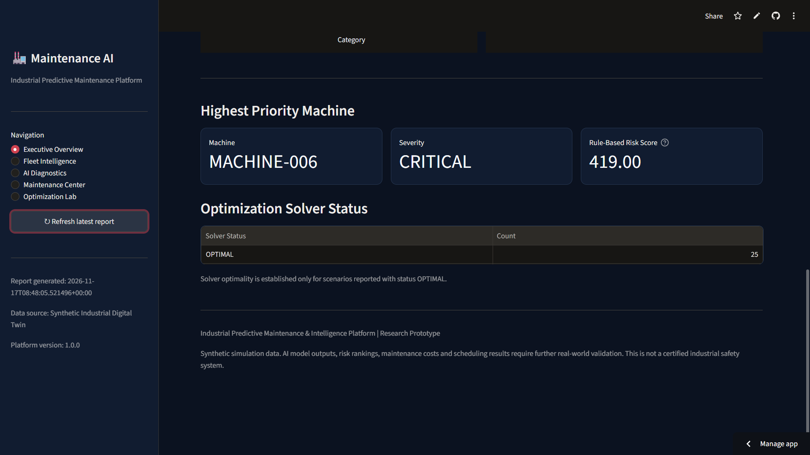

### 2. Fleet Intelligence

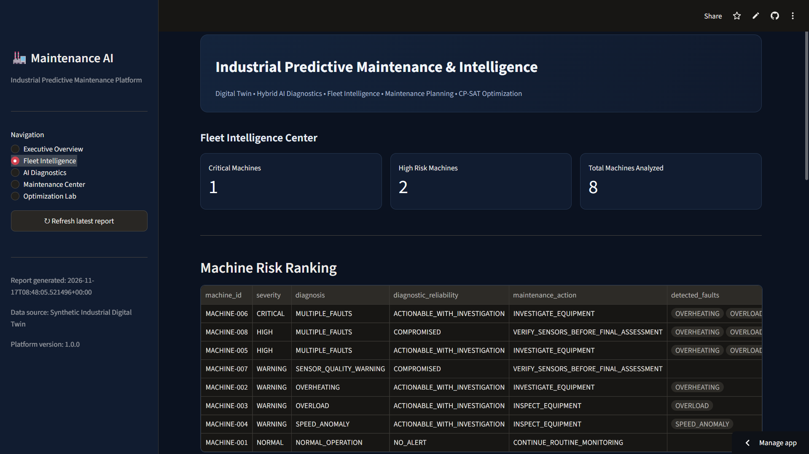

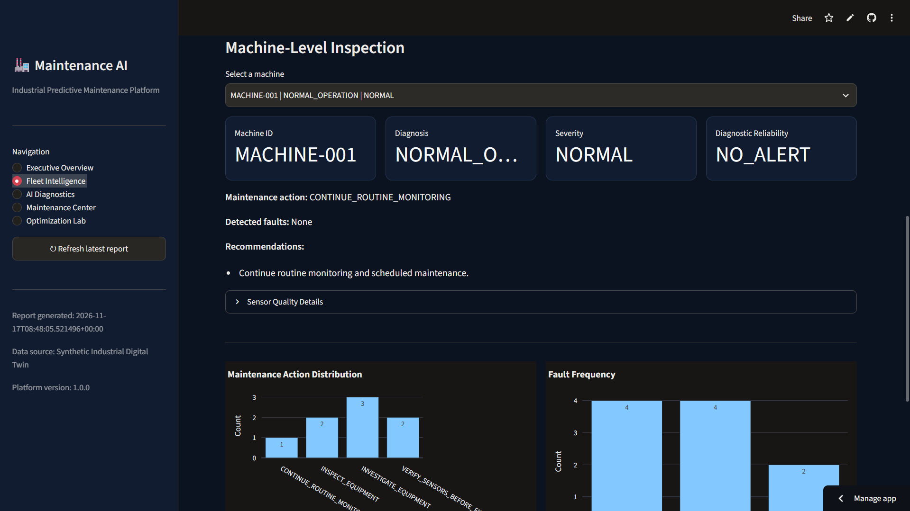

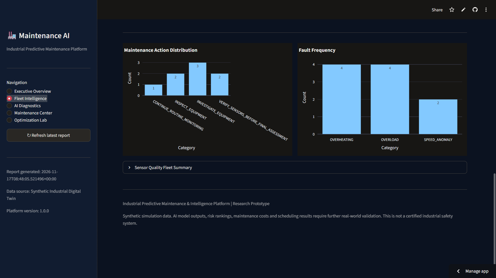

### 3. AI Diagnostics

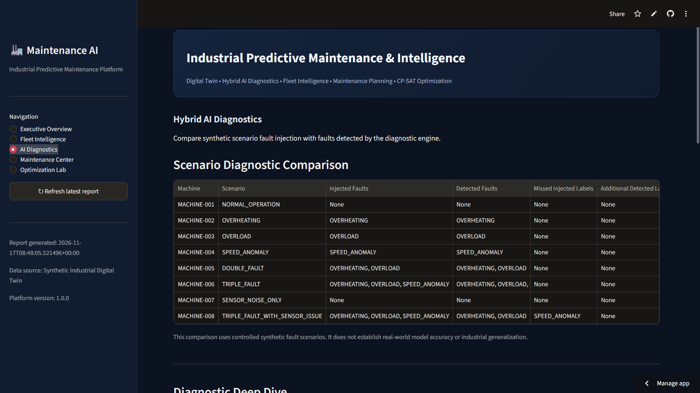

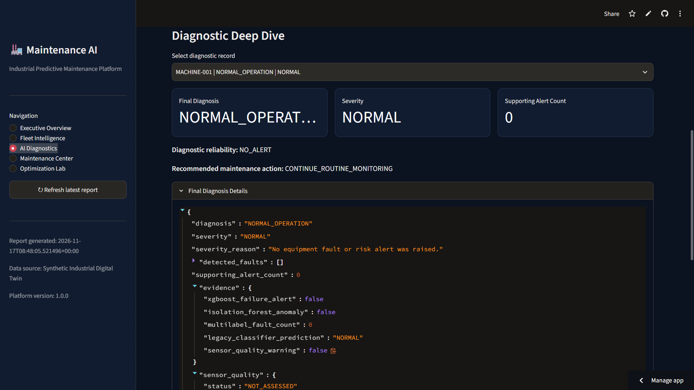

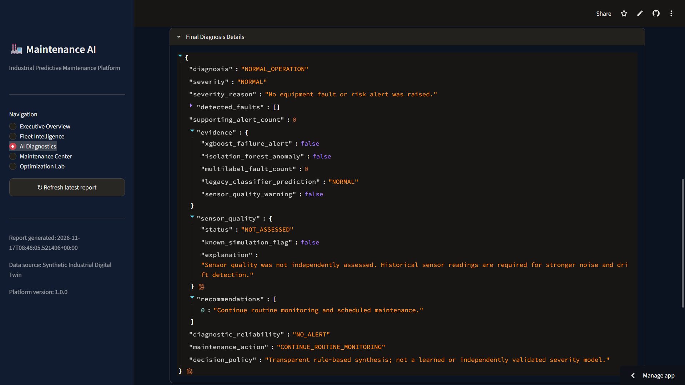

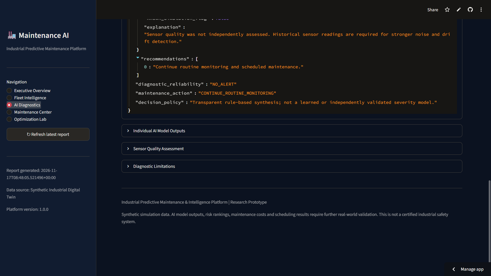

### SHAP Explainability

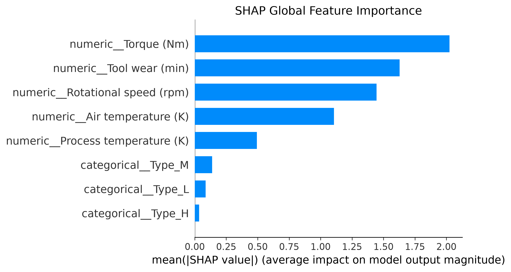

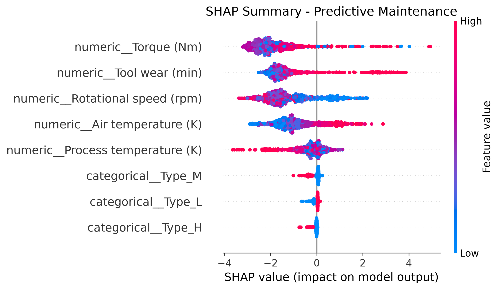

### 4. Maintenance Center

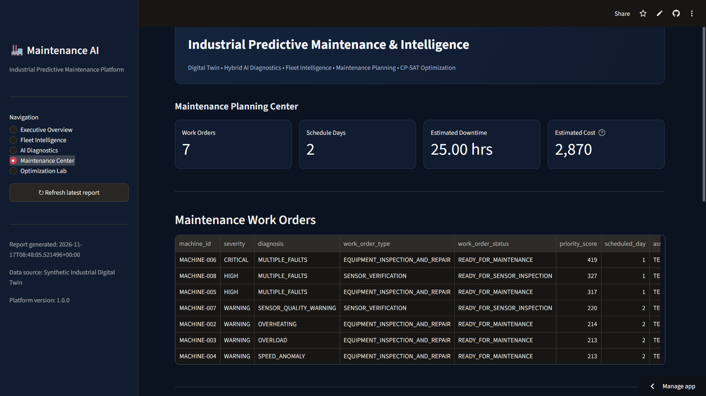

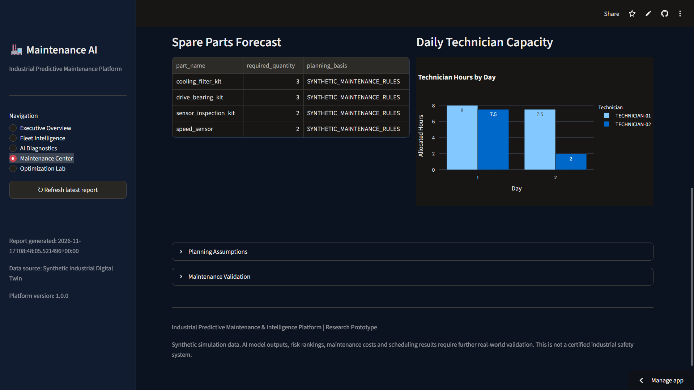

### 5. Optimization Lab

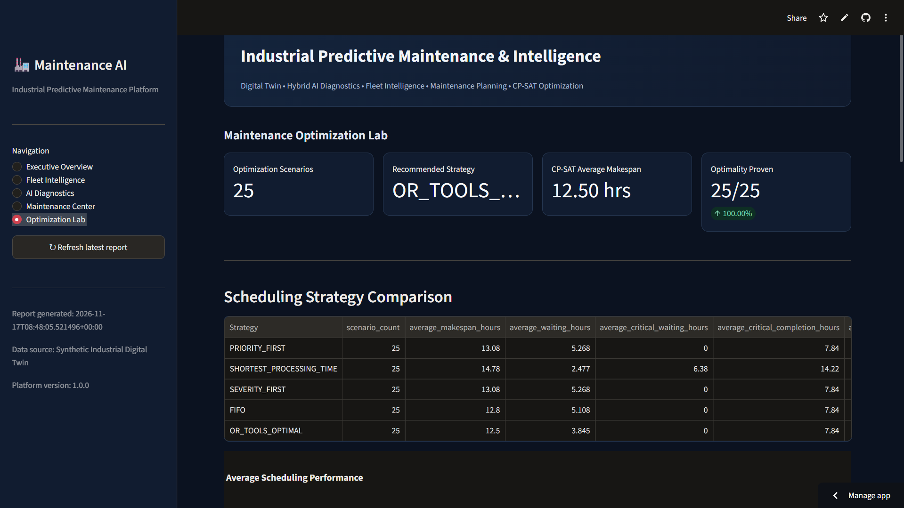

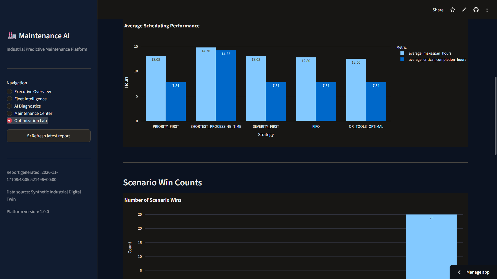

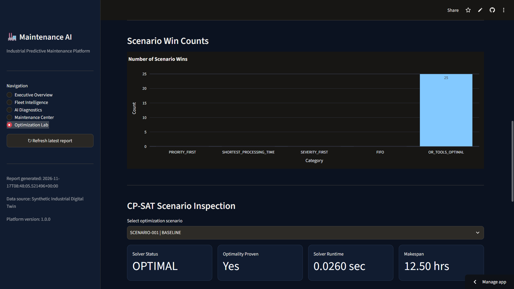

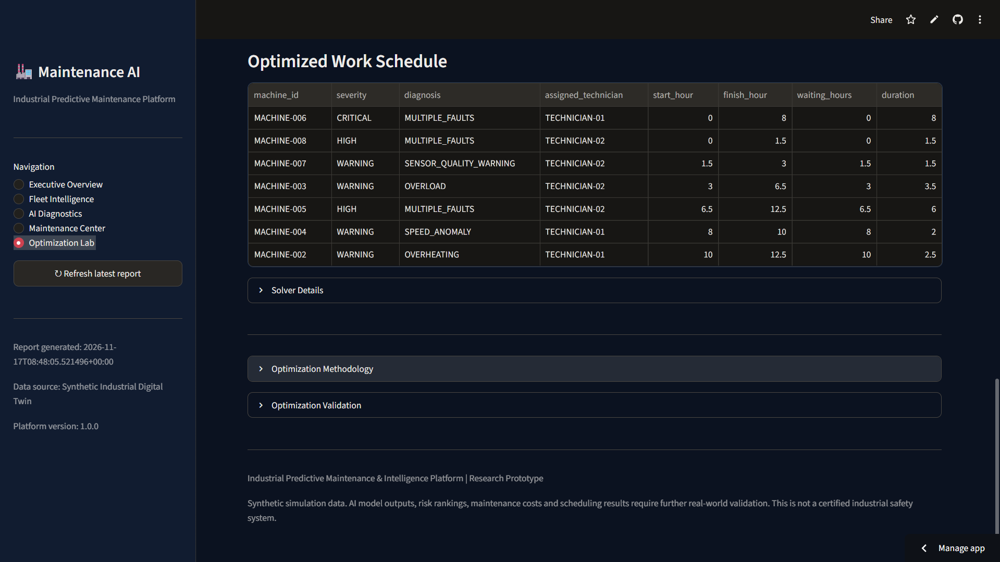

## Limitations and Future Improvements

The project is an experimental predictive maintenance prototype.

- The AI4I 2020 dataset is used for the XGBoost failure prediction model.
- The industrial digital twin and injected fault scenarios use simulated data.
- Synthetic fault classification results do not establish real-world industrial generalization.
- Machine risk ranking uses a transparent rule-based scoring system, not a calibrated failure probability.
- Maintenance costs and downtime are simulation estimates, not validated real-world values.
- CP-SAT optimality is established only for scenarios where the solver reports an optimal status.
- The platform is not a certified industrial safety or equipment-control system.

Potential future enhancements include:

- Real-time IoT sensor integration.
- Remaining Useful Life (RUL) estimation with suitable real-world degradation data.
- FastAPI-based model serving.
- Docker-based deployment.
- Model monitoring and data drift detection.
- Automated model retraining.
- Edge deployment for industrial environments.
- Integration with real maintenance management systems.

## Author

Developed as an end-to-end industrial predictive maintenance and machine intelligence portfolio project, demonstrating practical implementation of digital twin simulation, machine learning, explainable AI, fleet analytics, maintenance planning, mathematical optimization, dashboard development, and software testing.
